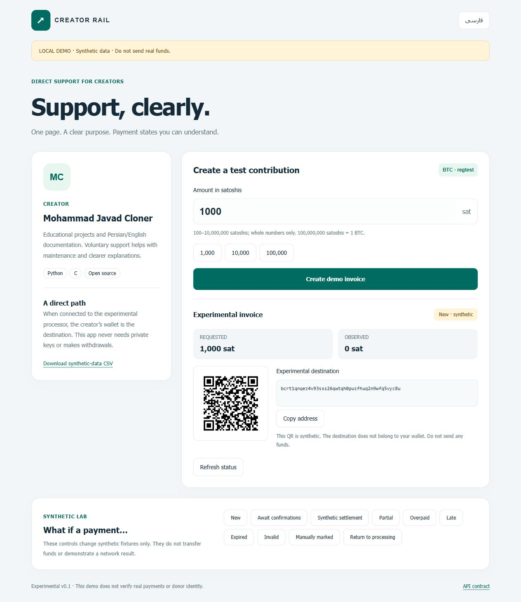

# Creator Rail

**A clear Persian/English support page on top of a payment processor.**

Local experimental Python/Web prototype. The default demo uses **synthetic regtest fixtures**: no blockchain is contacted, no wallet is created, and no funds move. Its QR destinations are generated public witness programs with no wallet behind them. **Do not send funds to the demo.**



The optional adapter implements the inspected BTCPay Greenfield invoice API. Mocked HTTP contract tests are not evidence of live BTCPay, Bitcoin Core, testnet, or mainnet operation. Mainnet configuration is rejected. This prototype is not an exchange, a custodial service, or a production payment platform.

## Run locally

Python 3.13 was used for local validation. Create a virtual environment, then:

```powershell
python -m pip install -r requirements.txt
python -m uvicorn app:app --host 127.0.0.1 --port 8031
```

Open **http://127.0.0.1:8031/**. The Persian page has an English toggle. Create a demo invoice and try the clearly labelled synthetic cases. Use the CSV link to export synthetic rows. No credentials are needed in demo mode.

```powershell
python -m pytest -q
```

## What is implemented

- Responsive RTL/LTR creator page, integer-satoshi input, a quiet-zone SVG QR and copyable experimental destination.
- Explicit synthetic payment scenarios: processing, partial, overpaid, late, invalid, expiry, manual marking, and returning to processing.
- Adapter for creating invoices in one configured store and reading their canonical status/payment method.
- Store/currency/amount checks; checksummed witness-v0 P2WPKH destination validation; same-origin checkout URLs.
- HMAC-authenticated webhook notifications that re-read provider state. A signed payload alone never confirms payment. Redeliveries do not add another invoice or increase a running ledger.
- Local SQLite snapshots, safe CSV of current observed states and a backup/restore helper.

The public invoice identifier is a random 192-bit locator. Treat invoice links as private if you do not want their amount/destination visible to others. The app does not infer donor identity from a transaction ID or provide donor messages/rewards.

## BTCPay adapter

See [integration instructions](docs/INTEGRATION.md). Configure your own experimental processor and store on the server. The app requests only invoice creation and reading, not wallet spending. Do not paste an API key, private key or recovery phrase into a chat or repository.

The prototype binds locally in the documented command and rejects non-local Host names. It is not a substitute for production authentication, network isolation or a security review. A public reverse-proxy deployment is outside this release's supported scope.

## Evidence and limitations

[Validation record](docs/RESULTS.md) · [API contract snapshot](docs/api-contract.json) · [Threat boundaries](docs/SECURITY.md) · [فارسی](README.fa.md)

The local tests cover synthetic state transitions and mocked BTCPay responses. Real BTCPay/regtest integration, a testnet wallet, independent usability review and a money-receiving pilot remain separate milestones. No revenue or user count is claimed.

Code and documentation were prepared with AI assistance under the owner's direction. BTCPay is an independent upstream project; this is not an official BTCPay product. MIT-licensed source; dependency and provider terms apply independently.
